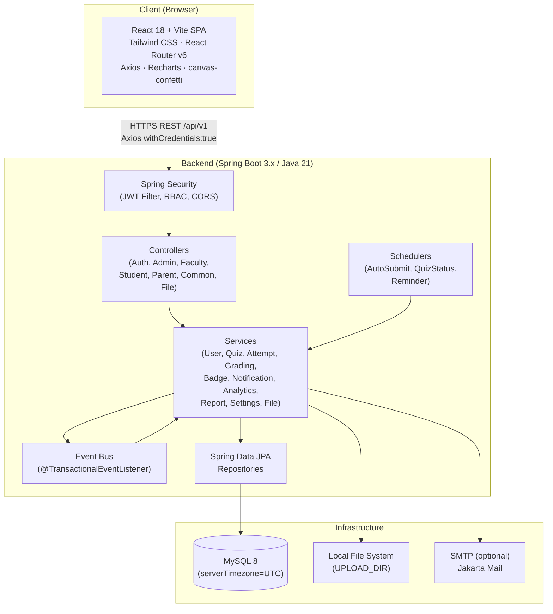
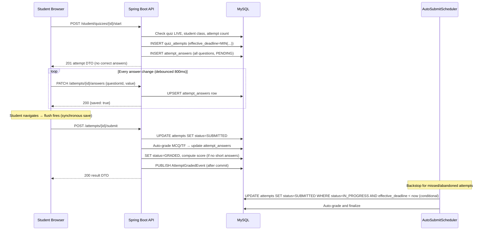
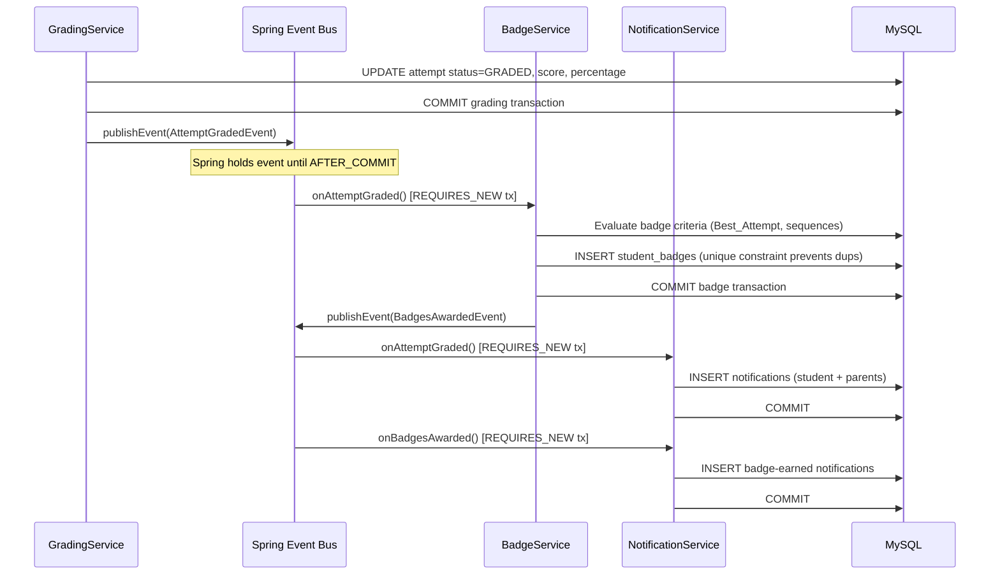
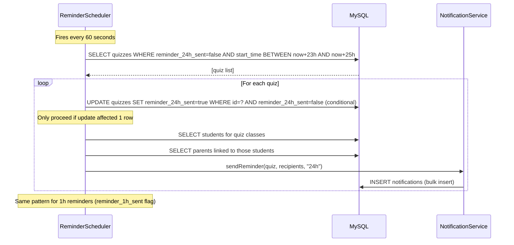

# Design Document: Nexus Quiz Portal

## Overview

The Nexus Quiz Portal is a full-stack web application for Nexus Ranaji English Medium School that replaces paper-based quiz management with a structured digital platform. Four user roles — Student, Parent, Faculty, and Admin (Principal) — each interact through a role-specific dashboard backed by a single Spring Boot REST API and a React/Vite single-page application. Faculty create questions, assemble quizzes, and grade short answers; Students attempt time-bounded quizzes with server-enforced timers, auto-save, and auto-submit; Parents monitor their linked children's performance in read-only mode; and the Admin manages the entire user and academic structure, configures school branding at runtime without a code rebuild, and views school-wide analytics and audit trails. The system stores all timestamps in UTC, displays them in IST (Asia/Kolkata, UTC+5:30), enforces RBAC on every API endpoint and route, and is designed for single-instance v1 deployment with a stateless JWT architecture that supports future horizontal scaling.

---

## Architecture



**Key architectural decisions:**

- **Stateless backend:** JWT access token (30 min) in `Authorization: Bearer` header; refresh token in `HttpOnly SameSite=Strict` cookie scoped to `/api/v1/auth/refresh`. No server-side session state — multiple instances can run without shared storage.
- **UTC-everywhere:** JVM started with `-Duser.timezone=UTC`; Hibernate `jdbc.time_zone=UTC`; MySQL `serverTimezone=UTC` in JDBC URL; all entity fields are `java.time.Instant`; IST conversion only in `DateTimeUtil` and in API response DTOs.
- **Single-instance v1:** Schedulers use conditional SQL updates for safety. ShedLock must be added before scaling to multiple instances.
- **Event-driven badge/notification dispatch:** `@TransactionalEventListener(phase=AFTER_COMMIT)` ensures badges and notifications are never emitted from a rolled-back grading transaction.
- **FileStorageService abstraction:** `LocalFileStorageService` in v1; the interface is designed for a cloud-storage swap (S3/Cloudinary) with no changes to callers.
- **Snapshot-at-publish:** `quiz_question_snapshots` are written when a quiz transitions to SCHEDULED, protecting scoring from later question edits.

---

## Components and Interfaces

### Backend Layer Table

| Layer | Classes | Responsibility |
|---|---|---|
| **Controller** | `AuthController`, `AdminController`, `FacultyController`, `StudentController`, `ParentController`, `CommonController`, `FileController` | Parse HTTP requests, delegate to services, serialize responses into `ApiResponse<T>` envelope |
| **Security** | `JwtFilter`, `JwtService`, `UserDetailsServiceImpl`, `RateLimitingFilter` | Extract/validate JWT on every request; enforce RBAC via `@PreAuthorize`; per-IP rate limiting (Bucket4j) |
| **Service** | `UserService`, `AcademicService`, `QuestionService`, `QuizService`, `AttemptService`, `GradingService`, `BadgeService`, `NotificationService`, `AnalyticsService`, `ReportService`, `SettingsService`, `FileStorageService` / `LocalFileStorageService` | All business logic; services are transaction owners; never expose entities to controllers |
| **Scheduler** | `AutoSubmitScheduler`, `QuizStatusScheduler`, `ReminderScheduler` | Background jobs at 1-minute intervals; use conditional SQL updates to be safe under re-entrant execution |
| **Event** | `AttemptGradedEvent`, `BadgesAwardedEvent` | Spring application events published after transaction commit; consumed by `BadgeService` and `NotificationService` listeners |
| **Repository** | One `JpaRepository` per entity | Spring Data JPA; all datetime comparisons use `Instant` and UTC |
| **Entity** | One class per DB table | All datetime fields as `java.time.Instant`; never `java.util.Date` or `java.sql.Timestamp` |
| **DTO** | Request/response DTOs per feature area | Separate from entities; response DTOs convert `Instant` → IST string in `DateTimeUtil`; no password fields on any logged or audited DTO |
| **Exception** | `GlobalExceptionHandler` (`@ControllerAdvice`), custom exception classes | Returns structured `ApiResponse` for all errors; suppresses stack traces in production profile |
| **Util** | `DateTimeUtil`, `CsvUtil`, `PdfUtil`, `PasswordUtil` | `DateTimeUtil` always uses `ZoneId.of("Asia/Kolkata")`, never `ZoneId.systemDefault()` |

### Frontend Component Inventory

| Category | Components |
|---|---|
| **Layout** | `AuthLayout`, `StudentLayout`, `ParentLayout`, `FacultyLayout`, `AdminLayout` |
| **Navigation** | `Sidebar`, `BottomNav`, `Drawer`, `Breadcrumbs`, `TopBar` |
| **Primitives** | `Button`, `Card`, `Modal`, `Table`, `Pagination`, `Badge`, `Spinner` |
| **Forms** | `FormInput`, `FormSelect`, `FormTextarea`, `FormCheckbox`, `FileUpload` |
| **Feedback** | `Skeleton`, `EmptyState`, `ErrorState`, `ConfirmDialog`, `SaveIndicator`, `TempPasswordModal` |
| **Quiz-taking** | `QuizTimer`, `QuestionPalette`, `ProgressBar`, `AnswerOption`, `QuizNavButtons`, `MarkReviewToggle` |
| **Charts** | `LineChart`, `BarChart`, `PieChart` (Recharts wrappers) |
| **Gamification** | `BadgeIcon`, `BadgeShelf`, `ConfettiOverlay` |
| **Notifications** | `NotificationBell`, `NotificationPanel`, `NotificationItem` |

### ThemeContext Pattern — CSS Variables + Runtime Override

`theme.js` exports default brand values as JS constants and as a CSS custom properties object:

```js
// frontend/src/theme.js
export const defaultColors = {
  primary: '#2563EB',
  secondary: '#F59E0B',
  success: '#22C55E',
  error: '#EF4444',
  warning: '#F97316',
  bg: '#F8FAFC',
  card: '#FFFFFF',
  text: '#1E293B',
};

export const toCssVars = (colors) => ({
  '--color-primary': colors.primary,
  '--color-secondary': colors.secondary,
  '--color-success': colors.success,
  '--color-error': colors.error,
  '--color-warning': colors.warning,
  '--color-bg': colors.bg,
  '--color-card': colors.card,
  '--color-text': colors.text,
});
```

`ThemeContext` fetches `GET /api/v1/settings` on app load and merges Admin overrides (only `primary` and `secondary`) on top of defaults, then injects the merged CSS vars into `:root`:

```js
// ThemeContext.jsx
const merged = { ...defaultColors, ...{ primary: settings.primaryColor, secondary: settings.secondaryColor } };
Object.entries(toCssVars(merged)).forEach(([k, v]) => document.documentElement.style.setProperty(k, v));
```

`tailwind.config.js` maps Tailwind tokens to these CSS variables:

```js
colors: {
  primary:   'var(--color-primary)',
  secondary: 'var(--color-secondary)',
  success:   'var(--color-success)',
  error:     'var(--color-error)',
  warning:   'var(--color-warning)',
  bg:        'var(--color-bg)',
  card:      'var(--color-card)',
  text:      'var(--color-text)',
}
```

Classes like `bg-primary`, `text-secondary`, `border-primary` automatically reflect Admin's runtime color choices without a rebuild.

### Axios Interceptor + Silent Refresh

```
App Load
  └── AuthContext.init()
        ├── calls POST /api/v1/auth/refresh directly (NOT via Axios interceptor)
        │     cookie is sent automatically (withCredentials)
        ├── on success → set accessToken in memory, mark user authenticated
        └── on failure → clear state, show login page

Axios Instance (axiosInstance.js)
  withCredentials: true
  baseURL: VITE_API_BASE_URL
  Request interceptor: attach Authorization: Bearer <accessToken>
  Response interceptor (401 handler):
    ├── if request was /auth/refresh → skip (prevents infinite loop)
    ├── else → call refreshTokenApi() (outside interceptor queue)
    │     ├── on success → retry original request with new token
    │     └── on failure → dispatch logout, redirect to /login
    └── queue concurrent 401s during refresh; replay all after token obtained
```

### `useAutoSave` Hook — Flush-on-Navigation Behavior

```
State: pendingAnswer (local), saveStatus ('idle'|'saving'|'saved'|'failed')

onAnswerChange(questionId, value):
  → update local state immediately (non-blocking, UI reflects instantly)
  → cancel existing debounce timer
  → start new debounce timer (800 ms)
    └── on fire: PATCH /api/v1/student/attempts/{id}/answers

onNavigate() [called before Prev/Next/Palette navigation]:
  → cancel debounce timer
  → if pendingAnswer exists:
      await PATCH (synchronous flush — navigation blocked until complete)
  → then render next question

Retry logic (network error or HTTP 5xx only):
  → attempt 1 after 1 s
  → attempt 2 after 2 s
  → attempt 3 after 4 s
  → all failed: show persistent SaveFailedBanner

4xx error (e.g., 403 after deadline, 404):
  → show specific error: "Save failed: submission window has closed"
  → stop retrying immediately
```

### FileStorageService Abstraction

```java
public interface FileStorageService {
    String store(MultipartFile file, String subfolder);  // returns UUID filename
    Resource load(String subfolder, String filename);
    void delete(String subfolder, String filename);
}

// v1 implementation
@Service
@ConditionalOnProperty(name="storage.type", havingValue="local", matchIfMissing=true)
public class LocalFileStorageService implements FileStorageService { ... }
```

Access rules enforced in `FileController`:
- `/api/v1/files/logo/{filename}` — public, no auth required (used on login page).
- `/api/v1/files/profile-photos/{filename}` — any authenticated user.
- `/api/v1/files/questions/{filename}` — any authenticated user with access to a quiz referencing that image.
- CSV templates — Admin only.
- All paths validated: filename must not contain `..` or `/` (prevents path traversal).
- Files stored with UUID names (not original filenames).

---

## Data Models

### Entity-Relationship Diagram

```mermaid
erDiagram
    users {
        BIGINT id PK
        VARCHAR full_name
        VARCHAR username UK
        VARCHAR email UK_nullable
        VARCHAR phone
        VARCHAR password_hash
        ENUM role
        BOOL is_active
        BOOL must_change_password
        INT failed_login_count
        DATETIME locked_until_utc
        VARCHAR profile_photo_url
        DATETIME created_at_utc
        DATETIME updated_at_utc
    }

    academic_years {
        BIGINT id PK
        VARCHAR name
        DATE start_date
        DATE end_date
        BOOL is_current
    }

    classes {
        BIGINT id PK
        VARCHAR name
        VARCHAR section
        BIGINT academic_year_id FK
    }

    subjects {
        BIGINT id PK
        VARCHAR name
        VARCHAR code UK
    }

    students {
        BIGINT id PK
        BIGINT user_id FK_UK
        BIGINT class_id FK
        VARCHAR roll_number
        VARCHAR admission_number
    }

    parent_student {
        BIGINT id PK
        BIGINT parent_user_id FK
        BIGINT student_id FK
        ENUM relation
    }

    faculty_assignments {
        BIGINT id PK
        BIGINT faculty_user_id FK
        BIGINT class_id FK
        BIGINT subject_id FK
    }

    questions {
        BIGINT id PK
        BIGINT created_by FK
        BIGINT subject_id FK
        VARCHAR class_level
        VARCHAR topic
        ENUM type
        TEXT text
        VARCHAR image_url
        ENUM difficulty
        INT marks
        TEXT explanation
        TEXT model_answer
        BOOL is_active
        DATETIME created_at_utc
        DATETIME updated_at_utc
    }

    question_options {
        BIGINT id PK
        BIGINT question_id FK
        VARCHAR option_key
        TEXT option_text
        BOOL is_correct
        INT sort_order
    }

    quizzes {
        BIGINT id PK
        VARCHAR title
        TEXT description
        BIGINT subject_id FK
        BIGINT created_by FK
        INT duration_minutes
        DATETIME start_time_utc
        DATETIME end_time_utc
        INT max_attempts
        BOOL shuffle_questions
        BOOL shuffle_options
        ENUM show_answers
        DECIMAL pass_percentage
        INT total_marks
        ENUM status
        BOOL reminder_24h_sent
        BOOL reminder_1h_sent
        DATETIME created_at_utc
        DATETIME updated_at_utc
    }

    quiz_classes {
        BIGINT id PK
        BIGINT quiz_id FK
        BIGINT class_id FK
    }

    quiz_questions {
        BIGINT id PK
        BIGINT quiz_id FK
        BIGINT question_id FK
        INT sort_order
        INT marks
    }

    quiz_question_snapshots {
        BIGINT id PK
        BIGINT quiz_id FK
        BIGINT question_id FK
        TEXT snapshot_text
        JSON snapshot_options
        VARCHAR correct_option_key
        INT marks
        ENUM type
        TEXT model_answer
        TEXT explanation
        VARCHAR image_url
        DATETIME created_at_utc
    }

    quiz_attempts {
        BIGINT id PK
        BIGINT quiz_id FK
        BIGINT student_id FK
        INT attempt_number
        DATETIME started_at_utc
        DATETIME submitted_at_utc
        DATETIME effective_deadline_utc
        ENUM status
        DECIMAL total_score
        DECIMAL percentage
        INT time_taken_seconds
        BOOL is_auto_submitted
        JSON question_order
        JSON option_orders
        DATETIME created_at_utc
        DATETIME updated_at_utc
    }

    attempt_answers {
        BIGINT id PK
        BIGINT attempt_id FK
        BIGINT quiz_question_id FK
        VARCHAR selected_option_key
        TEXT text_answer
        BOOL is_correct
        DECIMAL marks_awarded
        ENUM grading_status
        TEXT faculty_feedback
        BOOL marked_for_review
    }

    badges {
        BIGINT id PK
        VARCHAR code UK
        VARCHAR name
        TEXT description
        VARCHAR icon
        ENUM type
        DECIMAL min_percentage
        BOOL is_active
    }

    student_badges {
        BIGINT id PK
        BIGINT student_id FK
        BIGINT badge_id FK
        BIGINT quiz_attempt_id FK_nullable
        BIGINT quiz_id FK_nullable
        DATETIME awarded_at_utc
    }

    notifications {
        BIGINT id PK
        BIGINT user_id FK
        VARCHAR title
        TEXT message
        VARCHAR type
        VARCHAR link
        BOOL is_read
        DATETIME created_at_utc
    }

    refresh_tokens {
        BIGINT id PK
        BIGINT user_id FK
        VARCHAR token_hash UK
        DATETIME expires_at_utc
        BOOL revoked
    }

    school_settings {
        BIGINT id PK
        VARCHAR school_name
        VARCHAR logo_url
        VARCHAR primary_color
        VARCHAR secondary_color
        BOOL leaderboard_enabled
        BOOL email_notifications_enabled
        DATETIME updated_at_utc
    }

    audit_log {
        BIGINT id PK
        BIGINT admin_user_id FK
        VARCHAR action_type
        VARCHAR target_entity_type
        BIGINT target_entity_id
        JSON old_value
        JSON new_value
        DATETIME created_at_utc
    }

    users ||--o{ students : "is"
    users ||--o{ parent_student : "parent"
    students ||--o{ parent_student : "child"
    users ||--o{ faculty_assignments : "teaches"
    classes ||--o{ faculty_assignments : "taught_in"
    subjects ||--o{ faculty_assignments : "covered_by"
    academic_years ||--o{ classes : "contains"
    students }o--|| classes : "enrolled_in"
    users ||--o{ questions : "created_by"
    subjects ||--o{ questions : "belongs_to"
    questions ||--o{ question_options : "has"
    users ||--o{ quizzes : "created_by"
    subjects ||--o{ quizzes : "for_subject"
    quizzes ||--o{ quiz_classes : "targets"
    classes ||--o{ quiz_classes : "targeted_by"
    quizzes ||--o{ quiz_questions : "contains"
    questions ||--o{ quiz_questions : "used_in"
    quizzes ||--o{ quiz_question_snapshots : "snapshotted_in"
    questions ||--o{ quiz_question_snapshots : "snapshotted_as"
    quizzes ||--o{ quiz_attempts : "attempted_in"
    students ||--o{ quiz_attempts : "attempts"
    quiz_attempts ||--o{ attempt_answers : "has"
    quiz_questions ||--o{ attempt_answers : "answered_via"
    students ||--o{ student_badges : "earns"
    badges ||--o{ student_badges : "awarded_as"
    quiz_attempts ||--o{ student_badges : "triggers"
    users ||--o{ notifications : "receives"
    users ||--o{ refresh_tokens : "owns"
    users ||--o{ audit_log : "performed_by"
```

### Key Table Annotations

**`quiz_question_snapshots` — write-once at publish time:**
- Created when faculty publishes a quiz (DRAFT → SCHEDULED). Never updated or deleted.
- `snapshot_options` is a JSON array: `[{"key": "opt_a", "text": "Newton"}, {"key": "opt_b", "text": "Einstein"}]`. Keys are stable strings, not database IDs — this decouples scoring from the `question_options` table.
- `correct_option_key` is nullable for `SHORT_ANSWER` type.
- Unique constraint on `(quiz_id, question_id)` prevents duplicate snapshots.

**`quiz_attempts` — shuffle persistence:**
- `question_order`: JSON array of `quiz_question_id` values in the shuffled order for this attempt. Written once at attempt creation; never changed.
- `option_orders`: JSON map of `quiz_question_id → [option_key, ...]` for shuffled options. Written once at attempt creation.

**`attempt_answers` — key field:**
- `selected_option_key` stores a string key like `"opt_b"`, matched against `quiz_question_snapshots.correct_option_key` during auto-grading. The `selected_option_id` column (referencing `question_options`) is **not** used — the stable key approach is used instead.
- Unique constraint on `(attempt_id, quiz_question_id)` — one answer row per question per attempt (upsert on save).

**`quizzes` — reminder flags:**
- `reminder_24h_sent` and `reminder_1h_sent` are set to `true` before dispatching notifications and never reset. Prevents duplicate reminders if the scheduler fires more than once in a window.

**`student_badges` — quiz_id for uniqueness:**
- `quiz_id` (nullable FK) enables the unique constraint `(student_id, badge_id, quiz_id)`.
- For badges not tied to a specific quiz (e.g., Consistent Learner), `quiz_id` is null; uniqueness is enforced in application logic for null-quiz_id badges.

**All datetime columns** use `DATETIME(6)` type (microsecond precision), stored in UTC, compared with `UTC_TIMESTAMP()` in SQL. Never rely on MySQL session timezone.

### Complete Index and Unique Constraint List

**Indexes:**
- `quiz_attempts(student_id, quiz_id)` — composite
- `quiz_attempts(effective_deadline_utc, status)` — scheduler query
- `quizzes(start_time_utc)` — scheduler and reminder queries
- `quizzes(status, start_time_utc)` — live quiz lookup
- `notifications(user_id, is_read)` — bell unread count
- `students(class_id)` — class roster queries
- `refresh_tokens(token_hash)` — refresh lookup
- `student_badges(student_id, badge_id)` — badge shelf queries
- `attempt_answers(attempt_id, quiz_question_id)` — answer lookup
- `audit_log(admin_user_id, created_at_utc)` — audit page queries

**Unique constraints:**
- `users(username)`
- `users(email)` — enforced in application logic for non-null values (MySQL partial index workaround)
- `subjects(code)`
- `faculty_assignments(faculty_user_id, class_id, subject_id)`
- `quiz_classes(quiz_id, class_id)`
- `quiz_question_snapshots(quiz_id, question_id)`
- `question_options(question_id, option_key)`
- `quiz_questions(quiz_id, question_id)`
- `attempt_answers(attempt_id, quiz_question_id)`
- `student_badges(student_id, badge_id, quiz_id)` — null quiz_id handled in app logic
- `refresh_tokens(token_hash)`
- `parent_student(parent_user_id, student_id)`

---

## Backend Design

### Service Responsibility Table

| Service | Core Responsibilities |
|---|---|
| `UserService` | Create/edit/deactivate users; BCrypt hashing; Temporary_Password generation; bulk CSV upload (chunked); audit log writes for user actions |
| `AcademicService` | Academic year/class/subject/faculty assignment/parent-student link CRUD; constraint checks (409 on class deletion with enrolled students) |
| `QuestionService` | Question bank CRUD scoped to faculty assignments; image upload delegation to `FileStorageService`; soft-delete (is_active=false) |
| `QuizService` | Quiz CRUD; publish validation + snapshot creation; status transition logic; manual close (auto-submit in-progress attempts); duplicate quiz |
| `AttemptService` | Idempotent start; shuffle generation; `effective_deadline` computation; grace-period enforcement; lazy finalization on result read; answer visibility filtering |
| `GradingService` | Auto-grade MCQ/TF on submit; grading queue; faculty marks assignment; final score computation; publish `AttemptGradedEvent` after commit |
| `BadgeService` | Listen on `AttemptGradedEvent` (AFTER_COMMIT); evaluate all badge types; write `student_badges`; publish `BadgesAwardedEvent` |
| `NotificationService` | Listen on `AttemptGradedEvent` and `BadgesAwardedEvent`; create in-app notifications; optional email via Jakarta Mail |
| `AnalyticsService` | Dashboard data aggregation; always uses Best_Attempt per quiz per student |
| `ReportService` | CSV export (OpenCSV) and PDF export (OpenPDF) for quiz reports and student/faculty progress |
| `SettingsService` | Read/write `school_settings`; audit log write on settings change |
| `FileStorageService` | Store/load/delete files; UUID filename generation; path traversal validation |

### Key Algorithms

#### (a) Publish → Snapshot Creation

```
QuizService.publish(quizId, facultyId):
  1. Load quiz; assert status = DRAFT
  2. Validate all publish preconditions (5 checks in Req 5.4):
     a. quiz has >= 1 question
     b. start_time > now_utc
     c. end_time > start_time
     d. at least one class assigned
     e. all classes and subject within faculty's assignments
     → on any failure: throw QuizPublishValidationException (HTTP 400, specific message)
  3. For each question in quiz_questions:
     a. Load question + options from questions / question_options
     b. Build snapshot_options JSON: [{key: opt.option_key, text: opt.option_text}, ...]
     c. Find correct option → correct_option_key (null for SHORT_ANSWER)
     d. INSERT INTO quiz_question_snapshots (unique on quiz_id, question_id)
  4. SET quiz.status = SCHEDULED
  5. COMMIT
  Note: If a snapshot already exists for (quiz_id, question_id) (e.g., re-publish after revert),
        use INSERT ... ON DUPLICATE KEY UPDATE to refresh it.
```

#### (b) Idempotent Attempt Start

```
AttemptService.startAttempt(quizId, studentId):
  1. Load quiz; check quiz is LIVE (status=SCHEDULED AND now_utc BETWEEN start_time AND end_time,
     or status=LIVE)
  2. Check student belongs to a class assigned to the quiz
  3. Count existing attempts for (student_id, quiz_id)
  4. IF an IN_PROGRESS attempt exists → return it immediately (HTTP 200, idempotent)
  5. IF attempts_used >= quiz.max_attempts → throw HTTP 403
  6. CREATE attempt record:
     a. started_at = now_utc
     b. effective_deadline = MIN(started_at + duration_minutes*60s, quiz.end_time_utc) [as Instant]
     c. attempt_number = attempts_used + 1
     d. status = IN_PROGRESS
     e. IF shuffle_questions: generate shuffled List<quiz_question_id>, store as question_order JSON
     f. IF shuffle_options: for each question, generate shuffled List<option_key>, store in option_orders JSON
  7. CREATE attempt_answer rows for all quiz_question_ids (grading_status=PENDING, all nulls)
  8. COMMIT
  9. Return attempt DTO (HTTP 201 for new, 200 for existing)
```

#### (c) Correct-Answer Visibility Filter

```
AttemptService.filterAnswerVisibility(attempt, quiz, attemptsUsed):

  IF attempt.status = IN_PROGRESS:
    → STRIP: correct_option_key, is_correct, explanation from all question data
    → return stripped response

  IF attempt.status = SUBMITTED or GRADED:
    SWITCH quiz.show_answers:
      NEVER:
        → STRIP all correct answer data always

      AFTER_SUBMIT:
        → SHOW only when: attempt.status = GRADED
                          AND (attemptsUsed >= quiz.max_attempts OR quiz.status = CLOSED)
        → otherwise STRIP

      AFTER_END:
        → SHOW only when: attempt.status = GRADED AND quiz.status = CLOSED
        → otherwise STRIP
```

#### (d) Grace Period + Late Submit Deadline Handling

```
AttemptService.saveAnswer(attemptId, questionId, answerValue, studentId):
  1. Load attempt; assert attempt.student_id = studentId (auth check)
  2. IF attempt.status != IN_PROGRESS → return HTTP 403 "Attempt already submitted"
  3. now_utc = Instant.now()
  4. IF now_utc > attempt.effective_deadline + 10s:
       → return HTTP 403 "Submission window has closed"
     ELSE IF now_utc > attempt.effective_deadline (within grace):
       → accept save (no deadline violation within grace window)
  5. Upsert attempt_answers row for (attempt_id, quiz_question_id)
  6. Return HTTP 200

AttemptService.manualSubmit(attemptId, studentId):
  1. Load attempt; assert student ownership
  2. IF attempt.status = SUBMITTED or GRADED → return current result (idempotent, HTTP 200)
  3. now_utc = Instant.now()
  4. IF now_utc > attempt.effective_deadline AND now_utc <= attempt.effective_deadline + 10s:
       → submitted_at = attempt.effective_deadline  (late-but-grace: use deadline, not clock)
       → is_auto_submitted = false
     ELSE IF now_utc > attempt.effective_deadline + 10s:
       → return HTTP 403 "Submission window has closed"
     ELSE:
       → submitted_at = now_utc
  5. SET attempt.status = SUBMITTED, attempt.submitted_at = computed_time
  6. Call autoGradeAndFinalize(attempt)
```

#### (e) Lazy Finalization on Result Read

```
AttemptService.getResult(attemptId, studentId):
  1. Load attempt; check ownership
  2. IF attempt.status = IN_PROGRESS:
       a. IF now_utc > attempt.effective_deadline:
            → auto-submit: status=SUBMITTED, submitted_at=effective_deadline,
                           is_auto_submitted=true
            → call autoGradeAndFinalize(attempt)
       b. ELSE: return HTTP 403 "Attempt still in progress"
  3. IF attempt.status = SUBMITTED and attempt has no pending short answers:
       → call autoGradeAndFinalize(attempt)  [finalize if somehow missed]
  4. Load graded/partial result, apply filterAnswerVisibility, return
```

#### (f) Auto-Submit Scheduler (Conditional Update)

```
@Scheduled(fixedDelay = 60_000)  // every 60 seconds
AutoSubmitScheduler.run():
  now_utc = Instant.now()
  
  // Step 1: find expired IN_PROGRESS attempts
  // Uses conditional SQL to prevent race conditions:
  List<Long> expiredIds = repo.findExpiredInProgressAttemptIds(now_utc)
  // SQL: SELECT id FROM quiz_attempts WHERE status='IN_PROGRESS' 
  //      AND effective_deadline_utc < :now
  
  for each attemptId in expiredIds:
    // Conditional update — only succeeds if still IN_PROGRESS
    int rows = repo.conditionalSubmit(attemptId, now_utc)
    // SQL: UPDATE quiz_attempts SET status='SUBMITTED', submitted_at=:now,
    //      is_auto_submitted=true WHERE id=:id AND status='IN_PROGRESS'
    IF rows == 1:
      attempt = repo.findById(attemptId)
      autoGradeAndFinalize(attempt)

  // Step 2: also catch LIVE quizzes that are now CLOSED
  // (for SCHEDULED→LIVE→CLOSED transitions — handled by QuizStatusScheduler)
```

#### (g) Final Score Computation

```
GradingService.computeFinalScore(attempt):
  snapshots = load quiz_question_snapshots for quiz
  answers = load attempt_answers for attempt

  total_score = 0
  all_graded = true

  for each answer in answers:
    snapshot = snapshots[answer.quiz_question_id]
    IF snapshot.type = MCQ or TRUE_FALSE:
      is_correct = (answer.selected_option_key == snapshot.correct_option_key)
      marks_awarded = is_correct ? snapshot.marks : 0
      answer.is_correct = is_correct
      answer.marks_awarded = marks_awarded
      answer.grading_status = AUTO_GRADED
      total_score += marks_awarded
    ELSE (SHORT_ANSWER):
      IF answer.grading_status = GRADED:
        total_score += answer.marks_awarded
      ELSE:
        all_graded = false

  IF all_graded:
    attempt.total_score = total_score
    attempt.percentage = (total_score / quiz.total_marks) * 100
    attempt.status = GRADED
    attempt.time_taken_seconds = submitted_at - started_at (seconds)
    COMMIT
    PUBLISH AttemptGradedEvent(attempt)
  ELSE:
    attempt.status = SUBMITTED  (partial — pending short answer grading)
    COMMIT
```

#### (h) Badge Evaluation (AFTER_COMMIT Listener)

```
BadgeService.onAttemptGraded(AttemptGradedEvent event):
  [runs in REQUIRES_NEW transaction after outer commit]
  attempt = event.attempt
  student = attempt.student
  awardedBadges = []

  // Score badges (use Best_Attempt for this quiz if max_attempts > 1)
  bestPct = getBestAttemptPercentage(student.id, attempt.quiz_id)
  IF bestPct >= goldThreshold → award GOLD (for this quiz)
  ELSE IF bestPct >= silverThreshold → award SILVER
  ELSE IF bestPct >= bronzeThreshold → award BRONZE

  // Special: First Step
  IF countGradedAttempts(student.id) == 1 → award FIRST_STEP (quiz_id=null)

  // Special: Perfect Score
  IF attempt.percentage == 100 → award PERFECT_SCORE (quiz_id=attempt.quiz_id)

  // Special: Consistent Learner
  bestAttempts = getBestAttemptsOrderedByDate(student.id)  // one per quiz
  last5 = last 5 of bestAttempts
  IF last5.size() == 5 AND all(pct >= 60): award CONSISTENT_LEARNER (quiz_id=null)

  // Special: Rising Star (per subject)
  quizSubjectId = attempt.quiz.subject_id
  subjectBests = getBestAttemptsForSubjectOrderedByDate(student.id, quizSubjectId)
  last3 = last 3 of subjectBests
  IF last3.size() == 3 AND last3[0].pct < last3[1].pct < last3[2].pct:
    award RISING_STAR (quiz_id=attempt.quiz_id)

  // Quiz Champion — see (h) trigger conditions below
  checkQuizChampionEligibility(attempt.quiz_id)

  for each badge in awardedBadges:
    INSERT student_badges (unique constraint prevents duplicates)

  PUBLISH BadgesAwardedEvent(student, awardedBadges)

checkQuizChampionEligibility(quizId):
  quiz = load quiz
  IF quiz.status != CLOSED: return  (only evaluate when closed)
  pendingCount = countPendingShortAnswers(quizId)
  IF pendingCount > 0: return  (wait for all grading to complete)
  
  // Find highest Best_Attempt percentage for the quiz
  bestAttempts = getBestAttemptsForAllStudents(quizId)
  IF bestAttempts is empty: return
  maxPct = max(bestAttempts.percentage)
  champions = bestAttempts.filter(pct == maxPct)
  
  for each champion in champions:
    INSERT student_badges(student_id=champion.student_id, badge_id=QUIZ_CHAMPION,
                           quiz_id=quizId, quiz_attempt_id=champion.attempt_id)
    // unique constraint prevents duplicates if called multiple times

Quiz Champion trigger points:
  1. GradingService.finalizeAttempt → after finalize, if pendingShortAnswers(quizId)==0
     AND quiz.status=CLOSED → checkQuizChampionEligibility(quizId)
  2. QuizService.manualClose → after auto-submitting all attempts, if no pending
     short answers → checkQuizChampionEligibility(quizId)
  3. AutoSubmitScheduler → after processing all attempts for a newly-CLOSED quiz,
     same check
```

#### (i) @TransactionalEventListener Pattern

```java
// GradingService
@Transactional
public void finalizeAttempt(Long attemptId) {
    // ... compute score, set status=GRADED, save ...
    eventPublisher.publishEvent(new AttemptGradedEvent(attempt));
    // event is held until AFTER commit due to @TransactionalEventListener on listeners
}

// BadgeService
@TransactionalEventListener(phase = TransactionPhase.AFTER_COMMIT)
@Transactional(propagation = Propagation.REQUIRES_NEW)
public void onAttemptGraded(AttemptGradedEvent event) {
    // evaluate and award badges in a fresh transaction
    // ...
    eventPublisher.publishEvent(new BadgesAwardedEvent(student, badges));
}

// NotificationService
@TransactionalEventListener(phase = TransactionPhase.AFTER_COMMIT)
@Transactional(propagation = Propagation.REQUIRES_NEW)
public void onAttemptGraded(AttemptGradedEvent event) { ... }

@TransactionalEventListener(phase = TransactionPhase.AFTER_COMMIT)
@Transactional(propagation = Propagation.REQUIRES_NEW)
public void onBadgesAwarded(BadgesAwardedEvent event) { ... }
```

This ensures: if the grading transaction rolls back, no badges or notifications are emitted.

#### (j) Bulk Upload Chunking (Amendment 20)

```
POST /api/v1/admin/users/bulk-upload:
  1. Validate file size <= 5 MB; else HTTP 400
  2. Open streaming CSV reader (OpenCSV CsvReader)
  3. Validate header row against expected columns for the role;
     if invalid → HTTP 400 immediately (no rows processed)
  4. Process in chunks of 50 rows:
     for chunk in chunks:
       userService.processChunk(chunk, role)
         @Transactional  // new transaction per chunk
         for each row in chunk:
           validate row fields
           IF valid: create user, record success
           IF invalid: record failure (rowNumber, rowData, errorMessage), skip row
         // chunk transaction commits independently
  5. Aggregate results: totalRows, successCount, failureCount, failures[]
  6. Return HTTP 200 with summary (partial success is HTTP 200, not 207,
     for simplicity; failure details in response body)

Temporary passwords: included in per-row success data in the response body.
NEVER logged. Never in notifications. Never in audit log new_value.
```

#### (k) Reminder Scheduler with Flags (Amendment 7)

```
@Scheduled(fixedDelay = 60_000)
ReminderScheduler.run():
  now_utc = Instant.now()

  // 24-hour reminders
  window_start = now_utc + 23h
  window_end   = now_utc + 25h
  quizzes24h = quizRepo.findByReminderNotSentAndStartTimeBetween(
                 false, window_start, window_end)
  // SQL: WHERE reminder_24h_sent=false AND start_time BETWEEN :ws AND :we

  for each quiz in quizzes24h:
    // Set flag BEFORE dispatching to prevent double-send if dispatcher is slow
    int rows = quizRepo.conditionalSetReminder24hSent(quiz.id)
    // SQL: UPDATE quizzes SET reminder_24h_sent=true WHERE id=:id AND reminder_24h_sent=false
    IF rows == 1:
      notificationService.sendQuizReminder(quiz, "24 hours")

  // 1-hour reminders (same pattern with reminder_1h_sent)
  window_start = now_utc + 50m
  window_end   = now_utc + 70m
  quizzes1h = quizRepo.findByReminder1hNotSentAndStartTimeBetween(...)
  // ... same conditional-update pattern
```

---

## Frontend Design

### Full Page/Component Tree

```
AppRouter (AppRouter.jsx)
├── /unauthorized          UnauthorizedPage [public]
├── /404                   NotFoundPage [public]
│
├── AuthLayout             [public wrapper — no sidebar]
│   ├── /login             LoginPage
│   │     → LoginForm (React Hook Form) → authApi.login()
│   └── /change-password   ChangePasswordPage
│         → ChangePasswordForm → authApi.changePassword()
│
├── StudentLayout          [ProtectedRoute role=STUDENT]
│   ├── Sidebar (desktop), BottomNav (mobile <1024px)
│   ├── TopBar (school name, NotificationBell, ProfileMenu)
│   │
│   ├── /student/dashboard          StudentDashboard
│   │     → GreetingCard, BadgeShelf, UpcomingQuizCards,
│   │       RecentResults, AvgScore, SubjectBarChart, TrendLineChart
│   ├── /student/quizzes            QuizListPage
│   │     → QuizCard (Start button enabled only if LIVE)
│   ├── /student/quizzes/:id/start  QuizInstructionsPage
│   │     → InstructionsCard, StartButton → studentApi.startAttempt()
│   ├── /student/attempt/:id        QuizAttemptPage
│   │     → QuizTimer (amber@5min, red@1min), QuestionDisplay,
│   │       AnswerOptions, QuizNavButtons, QuestionPalette,
│   │       ProgressBar, MarkReviewToggle, SaveIndicator,
│   │       ConfirmDialog (on submit)
│   │     Hooks: useQuizAttempt, useAutoSave
│   ├── /student/results/:id        ResultPage
│   │     → ScoreSummary, PerQuestionReview (visibility-controlled),
│   │       ConfettiOverlay (Gold or new badge)
│   ├── /student/history            QuizHistoryPage
│   │     → FilterBar (subject, date), AttemptHistoryTable
│   ├── /student/badges             BadgesPage
│   │     → BadgeShelf (earned=color, unearned=greyed)
│   ├── /student/leaderboard        LeaderboardPage
│   │     → LeaderboardTable (rank, name_initial, score)
│   ├── /student/notifications      NotificationsPage
│   │     → NotificationList, MarkAllReadButton
│   └── /student/profile            ProfilePage
│         → ProfileForm, ChangePasswordSection, PhotoUpload
│
├── ParentLayout           [ProtectedRoute role=PARENT]
│   ├── Sidebar (desktop), BottomNav (mobile)
│   │
│   ├── /parent/dashboard           ParentDashboard
│   │     → ChildSelector, UpcomingQuizzes, AttemptHistory,
│   │       AvgScore, SubjectBarChart, TrendLineChart, BadgeShelf,
│   │       ClassRank (if leaderboard enabled)
│   ├── /parent/child/:studentId    ChildPerformancePage
│   │     → Full child performance view (same components as dashboard tab)
│   ├── /parent/notifications       NotificationsPage
│   └── /parent/profile             ProfilePage
│
├── FacultyLayout          [ProtectedRoute role=FACULTY]
│   ├── Sidebar (desktop), Drawer/hamburger (mobile)
│   │
│   ├── /faculty/dashboard          FacultyDashboard
│   │     → AssignmentsSummary, UpcomingQuizzes, PendingGradingCount
│   ├── /faculty/questions          QuestionBankPage
│   │     → QuestionFilterBar, QuestionTable, QuestionFormModal
│   ├── /faculty/quizzes            MyQuizzesPage
│   │     → QuizStatusFilter, QuizTable, QuizActionMenu
│   ├── /faculty/quizzes/new        QuizFormPage
│   ├── /faculty/quizzes/:id/edit   QuizFormPage
│   │     → QuizMetadataForm, QuestionPickerPanel, PublishButton
│   ├── /faculty/quizzes/:id/report QuizReportPage
│   │     → StatsCards, ScoreDistributionBar, StudentScoreTable,
│   │       NonAttemptList, ExportButtons
│   ├── /faculty/grading            GradingQueuePage
│   │     → GradingAttemptCard, AnswerGradingForm, SubmitGradeButton
│   ├── /faculty/students           StudentPerformancePage
│   │     → ClassSubjectFilter, StudentTrendTable, QuestionAnalysisTable
│   ├── /faculty/notifications      NotificationsPage
│   └── /faculty/profile            ProfilePage
│
└── AdminLayout            [ProtectedRoute role=ADMIN]
    ├── Sidebar (desktop), Drawer (mobile)
    │
    ├── /admin/dashboard            AdminDashboard
    │     → OverviewCards (students, faculty, quizzes, avg score),
    │       ClassProgressTable, FacultyActivityTable
    ├── /admin/users                UserManagementPage
    │     → UserFilterBar, UserTable, CreateUserModal,
    │       TempPasswordModal, BulkUploadModal, CSVTemplateDownload
    ├── /admin/classes              ClassManagementPage
    ├── /admin/subjects             SubjectManagementPage
    ├── /admin/assignments          FacultyAssignmentPage
    ├── /admin/parent-links         ParentLinksPage
    ├── /admin/progress/classes     ClassProgressPage
    │     → ClassSubjectFilter, ProgressTable, TopBottomStudents
    ├── /admin/progress/students/:id StudentProfilePage
    │     → AllAttempts, SubjectChart, TrendLine, BadgeShelf
    ├── /admin/faculty-progress     FacultyProgressPage
    │     → FacultyStatsTable (quizzes created/scheduled/conducted,
    │       avg score, participation rate, pending grading)
    ├── /admin/badges               BadgeRulesPage
    │     → BadgeThresholdForm (Gold/Silver/Bronze admin-editable)
    ├── /admin/settings             SchoolSettingsPage
    │     → SchoolNameForm, LogoUpload, ColorPickers,
    │       LeaderboardToggle, EmailNotificationsToggle
    ├── /admin/reports              ReportsPage
    │     → ReportTypeSelector, ExportButtons (CSV/PDF)
    ├── /admin/audit-log            AuditLogPage
    │     → AuditLogTable (paginated, filterable by action/date)
    ├── /admin/notifications        NotificationsPage
    └── /admin/profile              ProfilePage
```

### Tailwind CSS Variable Mapping

`tailwind.config.js` extension:

```js
// tailwind.config.js
module.exports = {
  content: ['./src/**/*.{js,jsx}'],
  theme: {
    extend: {
      colors: {
        primary:   'var(--color-primary)',
        secondary: 'var(--color-secondary)',
        success:   'var(--color-success)',
        error:     'var(--color-error)',
        warning:   'var(--color-warning)',
        bg:        'var(--color-bg)',
        card:      'var(--color-card)',
        text:      'var(--color-text)',
      },
      fontFamily: {
        sans: ['Nunito', 'Poppins', 'ui-sans-serif', 'system-ui'],
      },
      borderRadius: {
        '2xl': '1rem',
      },
    },
  },
  plugins: [],
};
```

`index.css` sets the default CSS variables (fallback before ThemeContext initializes):

```css
:root {
  --color-primary:   #2563EB;
  --color-secondary: #F59E0B;
  --color-success:   #22C55E;
  --color-error:     #EF4444;
  --color-warning:   #F97316;
  --color-bg:        #F8FAFC;
  --color-card:      #FFFFFF;
  --color-text:      #1E293B;
}
```

---

## API Design

### Standard Response Envelope

All responses use:
```json
{
  "success": true,
  "message": "Human-readable message",
  "data": { ... },
  "errors": null
}
```

Error responses:
```json
{
  "success": false,
  "message": "Validation failed",
  "data": null,
  "errors": [
    { "field": "username", "message": "Username already taken" }
  ]
}
```

### Critical Flow Request/Response Examples

#### 1. Login (with cookie details)

**Request:**
```
POST /api/v1/auth/login
Content-Type: application/json

{
  "usernameOrEmail": "alice.student",
  "password": "SecurePass1"
}
```

**Response (success, HTTP 200):**
```
HTTP/1.1 200 OK
Set-Cookie: refreshToken=<token>; HttpOnly; Secure; SameSite=Strict;
            Path=/api/v1/auth/refresh; Max-Age=604800
Content-Type: application/json

{
  "success": true,
  "message": "Login successful",
  "data": {
    "accessToken": "eyJhbGciOiJIUzI1NiJ9...",
    "tokenType": "Bearer",
    "expiresIn": 1800,
    "user": {
      "id": 42,
      "fullName": "Alice Kumar",
      "role": "STUDENT",
      "mustChangePassword": false
    }
  },
  "errors": null
}
```

**Response (account locked, HTTP 401):**
```json
{
  "success": false,
  "message": "Account locked due to too many failed attempts. Try again after 15 minutes.",
  "data": null,
  "errors": null
}
```

**Response (rate limit hit, HTTP 429):**
```
HTTP/1.1 429 Too Many Requests
Retry-After: 60

{
  "success": false,
  "message": "Too many requests. Please wait before trying again.",
  "data": null,
  "errors": null
}
```

#### 2. Start Attempt (Idempotent)

**Request:**
```
POST /api/v1/student/quizzes/7/start
Authorization: Bearer <accessToken>
```

**Response (new attempt, HTTP 201):**
```json
{
  "success": true,
  "message": "Attempt started",
  "data": {
    "attemptId": 301,
    "quizTitle": "Chapter 3 — Motion Quiz",
    "totalQuestions": 10,
    "durationMinutes": 30,
    "effectiveDeadline": "2024-03-15T09:30:00+05:30",
    "remainingSeconds": 1800,
    "firstQuestion": {
      "attemptQuestionId": 1,
      "questionNumber": 1,
      "text": "What is Newton's first law?",
      "type": "MCQ",
      "marks": 2,
      "imageUrl": null,
      "options": [
        { "key": "opt_a", "text": "An object at rest stays at rest..." },
        { "key": "opt_b", "text": "Force equals mass times acceleration" },
        { "key": "opt_c", "text": "Every action has an equal and opposite reaction" }
      ]
    }
  },
  "errors": null
}
```
Note: `correct_option_key`, `is_correct`, and `explanation` are **absent** from the response.

**Response (existing IN_PROGRESS attempt, HTTP 200 — idempotent):**
Same structure as above, `remainingSeconds` reflects actual remaining time.

#### 3. Auto-Save Answer (Grace Window Error)

**Request:**
```
PATCH /api/v1/student/attempts/301/answers
Authorization: Bearer <accessToken>
Content-Type: application/json

{
  "quizQuestionId": 5,
  "selectedOptionKey": "opt_b"
}
```

**Response (success, HTTP 200):**
```json
{
  "success": true,
  "message": "Answer saved",
  "data": { "saved": true },
  "errors": null
}
```

**Response (outside grace window, HTTP 403):**
```json
{
  "success": false,
  "message": "Submission window has closed. Your last answer may not have been saved.",
  "data": null,
  "errors": null
}
```

#### 4. Submit Attempt (Idempotent)

**Request:**
```
POST /api/v1/student/attempts/301/submit
Authorization: Bearer <accessToken>
```

**Response (first submit, HTTP 200 — MCQ only quiz, auto-graded immediately):**
```json
{
  "success": true,
  "message": "Quiz submitted successfully",
  "data": {
    "attemptId": 301,
    "status": "GRADED",
    "totalScore": 16,
    "totalMarks": 20,
    "percentage": 80.0,
    "passed": true,
    "timeTakenSeconds": 1023,
    "badgesEarned": ["SILVER"],
    "newBadgeEarned": true
  },
  "errors": null
}
```

**Response (already submitted, HTTP 200 — idempotent):**
Same body as above — returns current state without re-processing.

#### 5. Grade Short Answer (with Event Dispatch Note)

**Request:**
```
PUT /api/v1/faculty/grading/answers/884
Authorization: Bearer <accessToken>
Content-Type: application/json

{
  "marksAwarded": 3,
  "feedback": "Good explanation, but missed the unit."
}
```

**Response (HTTP 200 — last answer in attempt graded, triggers finalization):**
```json
{
  "success": true,
  "message": "Answer graded. Attempt finalized and student notified.",
  "data": {
    "answerId": 884,
    "marksAwarded": 3,
    "attemptFinalized": true,
    "attemptId": 301,
    "finalScore": 18,
    "finalPercentage": 90.0
  },
  "errors": null
}
```

Backend note: After committing the grading transaction, `AttemptGradedEvent` is published. `BadgeService` and `NotificationService` run in separate `REQUIRES_NEW` transactions via `@TransactionalEventListener(phase=AFTER_COMMIT)`.

---

## Key Data Flows

### 1. Quiz Attempt Lifecycle



### 2. Badge Award Flow (AFTER_COMMIT Event)



### 3. Notification Reminder Flow (with Reminder Flags)



---

## Security Design

### JWT Lifecycle + Cookie Configuration

```
Access Token:
  - Type: JWT signed with HS256 (secret from JWT_SECRET env var)
  - Expiry: 30 minutes
  - Claims: sub (userId), role, iat, exp
  - Transport: Authorization: Bearer header (NOT stored in cookies)
  - Client storage: JavaScript memory only (never localStorage)

Refresh Token:
  - Type: opaque random UUID; stored hashed (SHA-256) in refresh_tokens table
  - Expiry: 7 days
  - Cookie attributes:
      HttpOnly: true           (not accessible to JS)
      Secure: true             (HTTPS only; false in dev profile)
      SameSite: Strict         (blocks cross-site requests)
      Path: /api/v1/auth/refresh  (scoped — not sent on other requests)
      Max-Age: 604800          (7 days in seconds)
  - On refresh: old token invalidated (revoked=true), new token issued
  - On logout: token revoked in DB, cookie cleared

Silent Refresh on App Load:
  - AuthContext calls POST /api/v1/auth/refresh before rendering routes
  - This call is NOT routed through the Axios 401 interceptor
  - If successful: user is authenticated, access token stored in memory
  - If failed (401/500): user sees login page
```

### RBAC Layers

**Backend enforcement:**
1. `JwtFilter` — validates token on every request, sets `SecurityContext`
2. Spring Security `@PreAuthorize` on controller methods — role-level
3. Service-level data checks — `faculty.assignments`, `parent.linkedStudents`, etc.
4. `GlobalExceptionHandler` catches authorization failures → HTTP 403

**Frontend enforcement:**
1. `ProtectedRoute` — checks `auth.role` before rendering role layouts
2. API calls return 403 for unauthorized data — frontend shows `UnauthorizedPage`

### Data-Level Authorization Rules

| Role | Data Access Boundary |
|---|---|
| STUDENT | Only own `quiz_attempts`, `attempt_answers`, `student_badges` where `student_id = auth.studentId` |
| PARENT | Only data for students in `parent_student` where `parent_user_id = auth.userId` |
| FACULTY | Only quizzes, questions, attempts, analytics for `faculty_assignments` matching `auth.userId` |
| ADMIN | All data across all users and roles |

### Rate Limiting (Two Independent Rules)

```
Rule 1 — Per-IP (Bucket4j, in-memory):
  Endpoint: POST /api/v1/auth/login
  Limit: 20 requests per minute per IP address
  On exceed: HTTP 429, Retry-After header
  Fires BEFORE database check (protects DB from brute force)

Rule 2 — Per-username (Database):
  After 5 failed login attempts for a username:
    SET locked_until = now_utc + 15 minutes
  Subsequent logins before locked_until: HTTP 401 with lockout message
  Successful login: failed_login_count reset to 0
```

### File Serving Access Rules

| Path | Auth Required | Access Check |
|---|---|---|
| `/api/v1/files/logo/{filename}` | No | Public — used on login page |
| `/api/v1/files/profile-photos/{filename}` | Yes (any role) | Any authenticated user |
| `/api/v1/files/questions/{filename}` | Yes | User has access to a quiz containing this question |
| `/api/v1/admin/users/template` | Yes (ADMIN only) | Role check via `@PreAuthorize("hasRole('ADMIN')")` |

All file paths validated: filename must not contain `..` or `/`. Files stored with UUID names.

### Password-Never-Plaintext Enforcement

1. `PasswordUtil.hash(plaintext)` uses `BCryptPasswordEncoder(strength=12)` — the only place BCrypt is called.
2. `PasswordUtil.generate()` returns a random 12-character alphanumeric temporary password — returned to caller, not stored.
3. No DTO used for logging or auditing contains a password field.
4. `@JsonIgnore` on any internal DTO password field.
5. Audit log entries for user-create and password-reset record only the action type and target entity — not the password value.
6. In `application.yml`, Spring Security's `debug` mode is off in production profile.

### CORS Configuration

```yaml
# SecurityConfig.java (CorsConfiguration)
allowedOrigins: [${FRONTEND_URL}]   # never "*" — must be explicit
allowedMethods: [GET, POST, PUT, PATCH, DELETE, OPTIONS]
allowedHeaders: [Authorization, Content-Type]
allowCredentials: true               # required for HttpOnly cookie
```

---

## Correctness Properties

*A property is a characteristic or behavior that should hold true across all valid executions of a system — essentially, a formal statement about what the system should do. Properties serve as the bridge between human-readable specifications and machine-verifiable correctness guarantees.*

### Property 1: Timer Invariant

*For any* quiz attempt, the `effective_deadline` computed by the server must always equal `MIN(started_at + duration_minutes × 60 seconds, quiz.end_time)` as `Instant` values in UTC, and the `remaining_seconds` returned by any API response must never exceed `(effective_deadline − now_utc)` in seconds.

**Validates: Requirements 6.2, 20.5**

*Implementation note:* Test with generated `(started_at, duration_minutes, end_time)` triples including edge cases where `started_at + duration` equals `end_time`, where the quiz ends before the duration, and where the deadline is in the past.

### Property 2: Snapshot Immutability

*For any* quiz that has been published (status transitioned to SCHEDULED or beyond), no row in `quiz_question_snapshots` for that `quiz_id` is updated or deleted after its initial creation. The snapshot is write-once.

**Validates: Requirements 4.8, 6.16**

*Implementation note:* After creating a snapshot, run any set of edit operations on the parent question and verify via direct DB query that `quiz_question_snapshots` rows are unchanged. Property test: for any sequence of question-edit operations after publish, snapshot contents remain identical.

### Property 3: Answer Isolation

*For any* quiz attempt in `IN_PROGRESS` status, no API response at any JSON nesting level contains the fields `correct_option_key`, `is_correct` (when true), or `explanation`. This property holds regardless of question type, question order, or the number of answered questions.

**Validates: Requirements 6.6, 9.1, 23.6**

*Implementation note:* Serialize the full API response to a JSON string and assert that the strings `"correct_option_key"`, `"is_correct":true`, and `"explanation"` do not appear. Use property testing with varied question type combinations.

### Property 4: Best Attempt Consistency

*For any* `(student_id, quiz_id)` pair with two or more GRADED attempts, the attempt designated as the `best_attempt` must always be the one with the maximum `percentage` among all GRADED attempts for that pair. When two attempts share the maximum percentage, either may be designated (tie-breaking is stable after designation).

**Validates: Requirements 6.15, 10.11, 11.2, 12.3**

*Implementation note:* For any generated set of attempt percentages (e.g., [72.0, 85.5, 68.0, 91.0]), `getBestAttemptPercentage(studentId, quizId)` must return `MAX(percentages)`. Test with duplicates, single attempts, and monotonically increasing/decreasing sequences.

### Property 5: Badge GRADED-Only Invariant

*For any* row in `student_badges` that has a non-null `quiz_attempt_id`, the referenced `quiz_attempts` row must have `status = GRADED`. Badges are never awarded to SUBMITTED or IN_PROGRESS attempts.

**Validates: Requirements 10.1**

*Implementation note:* After any badge evaluation, query `SELECT COUNT(*) FROM student_badges sb JOIN quiz_attempts qa ON sb.quiz_attempt_id = qa.id WHERE qa.status != 'GRADED'` and assert it equals 0. Property: for any generated attempt lifecycle sequence, badge award only occurs after GRADED status is set.

### Property 6: Shuffle Stability

*For any* `attempt_id` with shuffle enabled, the question sequence and option sequences returned by `GET /student/attempts/{id}` are identical across all calls, regardless of how many times the endpoint is called or whether the browser was refreshed.

**Validates: Requirements 6.3, 6.4**

*Implementation note:* Call the resume endpoint 10+ times for the same `attempt_id` and assert the question order array is identical each time. Property: shuffle order = `question_order` JSON stored in `quiz_attempts` at creation time; the endpoint never re-shuffles.

### Property 7: Leaderboard Name Privacy

*For any* student record in the system, the leaderboard API response for that student must display only `first_name + " " + last_name[0] + "."` — never the full last name or any additional personal identifier. The `last_name` field must be absent from the leaderboard response JSON.

**Validates: Requirements 16.1**

*Implementation note:* For any generated student name `(firstName, lastName)`, the leaderboard display string must equal `firstName + " " + lastName.charAt(0) + "."`. Test with single-character last names, multi-word names, and names with special characters.

### Property 8: Role Data Boundary

*For any* authenticated request to `/api/v1/student/*`, no response contains `quiz_attempts`, `attempt_answers`, or `student_badges` rows where `student_id ≠ auth.studentId`. *For any* authenticated request to `/api/v1/parent/*`, no response contains data for a student not present in `parent_student` for `auth.userId`.

**Validates: Requirements 2.15, 12.5**

*Implementation note:* For any generated set of students and parent-student links, querying `/parent/children/{studentId}/results` with a parent not linked to `studentId` must return HTTP 403. For student endpoints, all returned attempt rows must have `student_id = auth.studentId`.

### Property 9: Temporary Password Never Persisted or Logged

*For any* user creation or password reset operation, the `users.password_hash` column value for that user must start with `$2a$` or `$2b$` (BCrypt prefix). No API response other than the single create/reset/bulk-upload success response contains a field named `temporaryPassword`. No `audit_log` row's `old_value` or `new_value` JSON contains any field with the word "password". No application log line at any level contains a plaintext password string matching the pattern of a generated temporary password.

**Validates: Requirements 1.2, 1.3, 1.4, 1.8, 2.1**

*Implementation note:* For any generated password string `p`: `BCryptPasswordEncoder.matches(p, hash)` must return true, and `hash.startsWith("$2a$") || hash.startsWith("$2b$")` must be true. Assert audit log `new_value` never contains keys `"password"`, `"temporaryPassword"`, or `"passwordHash"`.

### Property 10: UTC-Only Storage Invariant

*For any* datetime value stored in the database (quiz `start_time`, `end_time`, attempt `started_at`, `submitted_at`, `effective_deadline`, notification `created_at`, badge `awarded_at`, audit log `created_at`), converting it with `ZoneOffset.UTC` must produce the same `Instant` as the original value written by the application. No stored datetime embeds a timezone offset.

**Validates: Requirements 20.1, 20.3, 20.5**

*Implementation note:* For any generated `ZonedDateTime` in IST, converting to `Instant` for storage and back produces the same UTC moment. Assert `DateTimeUtil.toIst(instant)` always uses `ZoneId.of("Asia/Kolkata")` and never `ZoneId.systemDefault()`. Property test: `toIst(fromIst(zdt)).toInstant() == zdt.toInstant()` for any IST ZonedDateTime.

---

## Error Handling

### Global Exception Handler

All unhandled exceptions are caught by `GlobalExceptionHandler` (`@ControllerAdvice`) and returned in the standard `ApiResponse` envelope. Stack traces are never included in API responses in the production profile (`spring.profiles.active=prod`).

| Exception Type | HTTP Status | Behavior |
|---|---|---|
| `MethodArgumentNotValidException` | 400 | Field-level validation errors extracted from `BindingResult`; returned as `errors[]` array with `field` and `message` |
| `ConstraintViolationException` | 400 | Bean Validation failures on method parameters; same field-level format |
| `QuizPublishValidationException` | 400 | Descriptive message identifying which of the 5 publish conditions failed |
| `EntityNotFoundException` | 404 | "Resource not found" with entity type in message |
| `DuplicateEntityException` | 409 | Conflict on unique constraint violations (username, email, class enrollment) |
| `AuthorizationException` | 403 | Role boundary or data-level access violation |
| `AuthenticationException` | 401 | Invalid or expired token; missing Authorization header |
| `RateLimitExceededException` | 429 | Per-IP rate limit with `Retry-After` header |
| `FileSizeExceededException` | 400 | Image > 2 MB or CSV > 5 MB; descriptive message |
| `InvalidFileTypeException` | 400 | Non-JPEG/PNG/GIF image or invalid CSV headers |
| `AttemptWindowClosedException` | 403 | Save or submit after grace window |
| `Exception` (catch-all) | 500 | Logged server-side with full stack trace; client receives friendly message only |

### Frontend Error Handling

- Every page that fetches data renders `<Skeleton />` during loading, `<EmptyState />` when the response is empty, and `<ErrorState />` with friendly text on API errors.
- Axios response interceptor handles 401 (trigger silent refresh or redirect to login) and 403 (redirect to `/unauthorized`).
- Form validation errors from the API (`errors[]` array) are displayed adjacent to the relevant field using React Hook Form's `setError`.
- `react-hot-toast` shows transient success/error toasts for create, update, and delete actions.
- The `useAutoSave` hook shows `<SaveIndicator />` for save status and `<SaveFailedBanner />` after all retries are exhausted (see Components section).

### Notification Failure Isolation

Per Requirement 15.7, notification creation failures must not cause the triggering operation to fail. Because `NotificationService` runs in a separate `REQUIRES_NEW` transaction after `AFTER_COMMIT`, any exception in that transaction is caught and logged without rolling back the grading transaction. A `try/catch` in the `@TransactionalEventListener` method logs the error and continues.

### Scheduler Error Handling

Scheduler methods catch all exceptions per-attempt and log them individually, so a single failed auto-submit does not prevent other attempts from being processed in the same scheduler tick.

---

## Testing Strategy

### Dual Testing Approach

Unit tests and property tests are complementary and both are necessary for comprehensive coverage.

**Unit Tests (JUnit 5 + Mockito):**
- Specific examples and edge cases for each service method
- Integration points between services (e.g., GradingService → BadgeService event flow)
- Error conditions and exception handling
- Spring Boot integration tests for auth flow and quiz attempt lifecycle

**Property-Based Tests (jqwik for Java):**
- Each correctness property above maps to one `@Property` test in jqwik
- Minimum 100 tries per property (`@Property(tries = 100)`)
- Tag format: `@Tag("Feature: nexus-quiz-portal, Property N: <property_text>")`

**Frontend Tests:**
- Manual testing checklist per role (documented in README)
- Vitest + React Testing Library for key components: `useAutoSave` hook, `ThemeContext` CSS var injection, `QuizTimer` color transitions, `filterAnswerVisibility` logic

### Property Test Configuration

```java
// Example property test for Property 1: Timer Invariant
@Property(tries = 200)
@Tag("Feature: nexus-quiz-portal, Property 1: Timer Invariant")
void effectiveDeadlineIsMinOfDurationAndQuizEnd(
        @ForAll @InstantRange(min="2024-01-01T00:00:00Z", max="2030-12-31T00:00:00Z") Instant startedAt,
        @ForAll @IntRange(min=5, max=180) int durationMinutes,
        @ForAll @IntRange(min=1, max=1440) int endOffsetMinutes) {
    Instant quizEnd = startedAt.plusSeconds(endOffsetMinutes * 60L);
    Instant expected = startedAt.plusSeconds((long) durationMinutes * 60)
                                .isBefore(quizEnd)
                       ? startedAt.plusSeconds((long) durationMinutes * 60)
                       : quizEnd;
    Instant actual = AttemptService.computeEffectiveDeadline(startedAt, durationMinutes, quizEnd);
    assertThat(actual).isEqualTo(expected);
}
```

### PBT Applicability Assessment

PBT IS appropriate for this feature because:
- Core business logic (timer, snapshot, scoring, badge evaluation) involves pure functions with clear input/output behavior
- Universal invariants hold across wide input ranges (any percentage, any datetime, any role combination)
- 100+ iterations meaningfully probe edge cases (boundary percentages, concurrent attempts, shuffle stability)

PBT is NOT used for:
- Spring Security filter configuration (smoke tests)
- Flyway migration execution (integration test)
- Recharts rendering (manual/visual tests)
- Email dispatch (mock-based unit tests)

---

## Build Order

### Phase 1 — Project Setup

- Initialize Git repository with `.gitignore` (covering `*.env`, `target/`, `node_modules/`, `UPLOAD_DIR`)
- Create `docker-compose.yml` for MySQL 8 with `serverTimezone=UTC` in environment
- Create `.env.example` with all backend and frontend environment variable keys
- Spring Boot Maven project scaffold (`pom.xml` with all dependencies: Spring Web, Security, Data JPA, Validation, Lombok, Springdoc OpenAPI, OpenCSV, OpenPDF, Flyway, MySQL connector, jqwik, Bucket4j, Jakarta Mail optional)
- Set JVM timezone flag in Maven Spring Boot plugin: `<jvmArgument>-Duser.timezone=UTC</jvmArgument>`
- Write `V1__init_schema.sql` Flyway migration (all tables, indexes, unique constraints as documented)
- Write `V2__seed_badges.sql` (default Gold/Silver/Bronze badge rules)
- Vite React scaffold (`npm create vite@latest frontend -- --template react`)
- Install all frontend dependencies (Tailwind, React Router v6, Axios, React Hook Form, Recharts, Lucide React, react-hot-toast, canvas-confetti)
- Configure `tailwind.config.js` with CSS variable color tokens
- Create `frontend/src/theme.js` and `frontend/src/index.css` with default CSS variables
- Write `README.md` skeleton with setup instructions
- Verify `application.yml` has `spring.jpa.properties.hibernate.jdbc.time_zone=UTC` and MySQL JDBC URL includes `serverTimezone=UTC`

### Phase 2 — Database + Authentication

- JPA entities: `User`, `RefreshToken`, `AcademicYear`, `Class`, `Subject` (all fields as `Instant` for datetime)
- `DateTimeUtil` utility class (IST conversions, never `ZoneId.systemDefault()`)
- `JwtService` (generate/validate access tokens; HS256, secret from env var)
- `JwtFilter` (extract Bearer token, set SecurityContext)
- `SecurityConfig` (CORS with `allowCredentials=true`, `allowedOrigins=[FRONTEND_URL]`, stateless session)
- `AuthController`: `POST /auth/login`, `POST /auth/refresh` (reads HttpOnly cookie), `POST /auth/logout`, `POST /auth/change-password`, `GET /auth/me`
- `UserDetailsServiceImpl` (load user by username or email)
- `RefreshTokenService` (generate, validate, revoke; store SHA-256 hash in DB)
- `RateLimitingFilter` (Bucket4j per-IP 20 req/min on `/auth/login`)
- `GlobalExceptionHandler` (`@ControllerAdvice`, standard `ApiResponse` envelope)
- Frontend: `AuthContext.jsx` (silent refresh on app load outside Axios interceptor), `axiosInstance.js` (interceptor with 401 handler and request queue), `ProtectedRoute.jsx`, `AppRouter.jsx`, `LoginPage`, `ChangePasswordPage`

### Phase 3 — Admin Module

- JPA entities: `Student`, `ParentStudent`, `FacultyAssignment`, `AuditLog`, `SchoolSettings`
- `UserService`: create/edit/deactivate users; `PasswordUtil.generate()` + BCrypt hash; `TempPasswordModal` one-time display; audit log writes (no password in `new_value`)
- `UserService.bulkUpload()`: streaming CSV (chunks of 50), per-chunk `@Transactional`, response with `successCount`, `failureCount`, `failures[]`
- `AcademicService`: CRUD for academic years/classes/subjects/faculty assignments/parent-student links; 409 on class delete with enrolled students
- `SettingsService`: read/write `school_settings`; audit log write on change
- `AdminController`: all admin endpoints, `@PreAuthorize("hasRole('ADMIN')")`
- `FileController`: logo upload/serve (public), CSV template download (admin only), path traversal validation
- Frontend: `UserManagementPage`, `TempPasswordModal`, `BulkUploadModal`, `ClassManagementPage`, `SubjectManagementPage`, `FacultyAssignmentPage`, `ParentLinksPage`, `SchoolSettingsPage` (color pickers, logo upload, toggles), `AuditLogPage`, `ThemeContext.jsx` (CSS var injection on settings fetch)

### Phase 4 — Faculty Module

- JPA entities: `Question`, `QuestionOption`, `Quiz`, `QuizClass`, `QuizQuestion`, `QuizQuestionSnapshot`
- `QuestionService`: CRUD scoped to `faculty_assignments`; image upload via `FileStorageService`; soft-delete
- `QuizService`: quiz CRUD; `publish()` (5-condition validation + snapshot creation at publish time); `manualClose()` (set end_time=now, auto-submit IN_PROGRESS attempts, check Quiz Champion eligibility); `duplicate()`
- `QuizStatusScheduler`: every 60s, transitions SCHEDULED→LIVE, LIVE→CLOSED using conditional SQL updates
- `GradingService`: grading queue (`PENDING` short answers grouped by quiz); `gradeSingleAnswer()`; `finalizeAttempt()` (compute score, set GRADED, publish `AttemptGradedEvent` after commit)
- Frontend: `QuestionBankPage`, `QuizFormPage` (question picker, publish button), `GradingQueuePage`, `QuizReportPage`, `StudentPerformancePage`, `MyQuizzesPage`

### Phase 5 — Student Module

- JPA entities: `QuizAttempt`, `AttemptAnswer`
- `AttemptService`: idempotent `startAttempt()` (shuffle generation, effective_deadline); `getAttempt()` (resume — returns saved state + remaining_seconds); `saveAnswer()` (grace period enforcement, upsert); `submit()` (idempotent, late-grace deadline handling); `getResult()` (lazy finalization); `filterAnswerVisibility()` (all 3 show_answers modes, Amendment 3 strictness)
- `AutoSubmitScheduler`: every 60s, conditional `UPDATE ... WHERE status='IN_PROGRESS' AND effective_deadline < now`
- Frontend: `QuizAttemptPage` with `useQuizAttempt` hook and `useAutoSave` hook (flush-on-nav, debounce 800ms, retry policy), `QuizTimer` (amber@5min, red@1min), `QuestionPalette`, `ProgressBar`, `SaveIndicator`, `ConfirmDialog`, `ResultPage` (visibility-controlled answer review), `ConfettiOverlay` (Gold result or new badge), `QuizHistoryPage`, `BadgesPage`

### Phase 6 — Parent Module

- `ParentController`: all endpoints restricted to linked students; 403 for unlisted student IDs
- Frontend: `ParentDashboard` (child selector), `ChildPerformancePage` (read-only analytics for one child)

### Phase 7 — Dashboards and Charts

- `AnalyticsService`: all aggregation queries (always using Best_Attempt per quiz per student); student/faculty/class-wise views; leaderboard (name initial only)
- `ReportService`: CSV via OpenCSV, PDF via OpenPDF with school name header
- Frontend: Recharts wrappers (`LineChart`, `BarChart`, `PieChart`), `AdminDashboard`, `FacultyDashboard`, `StudentDashboard`, `ParentDashboard`, `ClassProgressPage`, `FacultyProgressPage`, `LeaderboardPage`, `ReportsPage`

### Phase 8 — Notifications, Badge Events, Email

- `NotificationService`: create in-app notifications for all 6 triggers; optional email via Jakarta Mail (flag-gated by `email_notifications_enabled` in `school_settings`)
- `BadgeService`: `@TransactionalEventListener(AFTER_COMMIT)` on `AttemptGradedEvent`; evaluate all badge types (Best_Attempt sequences for Consistent Learner and Rising Star; Quiz Champion with closed-quiz + no-pending-short-answers check); `REQUIRES_NEW` transaction
- `ReminderScheduler`: every 60s; conditional flag update before dispatch; 24h and 1h windows
- Frontend: `NotificationBell` (unread count), `NotificationsPage` (mark read/mark all), `BadgesPage` (earned + greyed unearned), `ConfettiOverlay` (badge celebration animation via canvas-confetti)

### Phase 9 — Polish and Testing

- Write `S1__dev_seed_data.sql` (dev-seed Flyway location): 1 admin, 3 faculty, 2 classes, 5 subjects, 10 students, 6 parents, 30 questions, 4 quizzes with attempts so all charts show data
- Configure `application-dev.yml` with `spring.flyway.locations: classpath:db/migration,classpath:db/dev-seed`
- JUnit 5 + Mockito service tests for: `AttemptService.computeEffectiveDeadline`, `GradingService.computeFinalScore`, `BadgeService` badge logic, `AttemptService.filterAnswerVisibility`, `UserService.hashPassword`
- jqwik property tests for all 10 Correctness Properties (min 100 tries each)
- Spring Boot integration tests: full auth flow (login → refresh → logout), quiz attempt lifecycle (start → save → submit → grade → result)
- Postman collection covering all main endpoints
- Accessibility pass: WCAG AA contrast, keyboard focus indicators, alt text, form labels, ARIA attributes on dynamic elements (timer, palette, badge modals)
- `FileStorageService` and file-serving controller with path traversal tests
- Rate limiting smoke test (verify HTTP 429 after 20 requests/min per IP)
- README finalization with prerequisites, startup steps, default admin credentials note, Swagger UI URL, Postman import instructions, backup/restore notes

---
